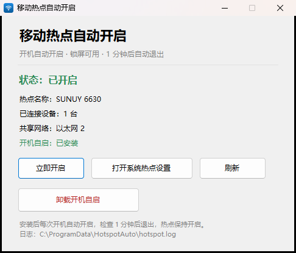

# HotspotAuto

A standalone Windows utility that turns on the **Mobile Hotspot at boot**, before you sign in.
It does not depend on DSH, Python, .NET 8, or any third-party runtime — a single exe is enough.

[中文](README.md) | **English**



## Features

- Turns on the Mobile Hotspot automatically at boot — it is already broadcasting on the lock/sign-in screen (runs as a SYSTEM scheduled task).
- Checks every 10 seconds for about 1 minute after startup to confirm the hotspot is stable.
- **Exits automatically after 1 minute**; no background process is left behind. Windows keeps the hotspot on.
- GUI: status, SSID, connected devices, shared network.
- One-click install/uninstall of the boot task.
- Log: `C:\ProgramData\HotspotAuto\hotspot.log`.

> This tool does **not** bypass the Windows login password or enable automatic sign-in.
> It only starts the hotspot before sign-in, so it is already available on the lock screen.

## Requirements

- Windows 10 (1803 or later) or Windows 11
- A wireless adapter that supports Windows Mobile Hotspot
- No .NET runtime installation required (uses the built-in .NET Framework 4.x)

## Download

Download `HotspotAuto-1.0.0.zip` from [Releases](../../releases/latest), extract it, and run `HotspotAuto.exe`.
You can also download `HotspotAuto.exe` directly (single file).

> The GUI and command-line messages are currently in Chinese; this English README documents the same behavior.

## Quick start

1. Double-click `HotspotAuto.exe`.
2. Click **安装开机自启** (Install at startup).
3. When you see **开机自启：已安装** (Startup: installed), you're done.

> If Windows SmartScreen appears, click **More info → Run anyway** (the exe is not code-signed).
> Some antivirus products may ask for permission to create a scheduled task; allow it.

From then on, the hotspot starts automatically at every boot. The program checks for about 1 minute and then exits, leaving the hotspot on.
To change the hotspot name or password, open **Settings → Network & Internet → Mobile hotspot**.

## Fast Startup (important)

Windows 11 enables **Fast Startup** by default. With Fast Startup, an "At startup" scheduled task may not fire. This app also registers a **Kernel-General 12** event trigger and a per-user Run entry as a fallback. If the hotspot does not start after a shutdown:

- Run `关闭快速启动.bat` (Disable Fast Startup) as administrator, then shut down and boot again; or
- Use **Restart** instead of **Shut down** (Restart performs a full boot).

`恢复快速启动.bat` restores the default setting.

## User interface

- **Status**: on / off / switching
- **Hotspot name**: current SSID
- **Connected devices**: client count
- **Shared network**: the adapter currently providing Internet access (Ethernet / Wi-Fi)
- **Startup**: whether the scheduled task is installed
- Buttons: **立即开启** (Turn on now), **打开系统热点设置** (Open Windows hotspot settings), **刷新** (Refresh), **安装开机自启 / 卸载开机自启** (Install / Uninstall startup)

## Command line

```text
HotspotAuto.exe            Open the GUI
HotspotAuto.exe status     Show status
HotspotAuto.exe on         Turn the hotspot on now
HotspotAuto.exe off        Turn the hotspot off now (if the startup monitor is still in its 1-minute window, it may turn it back on after 10 seconds)
HotspotAuto.exe install    Install startup task (auto-elevates)
HotspotAuto.exe uninstall  Remove startup task (auto-elevates)
HotspotAuto.exe install --quiet    Silent install
HotspotAuto.exe uninstall --quiet  Silent uninstall
HotspotAuto.exe help       Show help
HotspotAuto.exe version    Show version
```

## How it works

- On install, the exe is copied to `C:\Program Files\HotspotAuto\`.
- A scheduled task named `HotspotAuto` is created:
  - Runs as `NT AUTHORITY\SYSTEM` with the highest privileges.
  - Triggers: at system startup (20-second delay) + Kernel-General 12 system-start event.
  - Runs `HotspotAuto.exe run`: waits for Internet access, then calls Windows' built-in `NetworkOperatorTetheringManager` to turn on the hotspot.
  - Checks every 10 seconds for 60 seconds; once stable, the process exits and the hotspot stays on.
  - If no Internet is available within 120 seconds, it also exits instead of staying resident.
- A per-user `HKCU\...\Run` entry is added as a fallback after sign-in.
- A global mutex ensures only one startup monitor runs at a time.

## Uninstall

- Open the app and click **卸载开机自启** (Uninstall startup); or
- Run `卸载开机自启.bat`; or
- Run `HotspotAuto.exe uninstall`.

Uninstall removes the scheduled task, the Run entry, `C:\Program Files\HotspotAuto`, and `C:\ProgramData\HotspotAuto`. The hotspot itself is not turned off.

## FAQ

**The hotspot is on but my phone has no Internet.**
Check whether **Shared network** has Internet access. The app only turns the hotspot on; if the upstream connection drops, the hotspot stays on. The app retries automatically only during the first minute after startup; after that, fix it manually.

**Does the program keep running in the background?**
No. It runs for about 1 minute at each boot: turns the hotspot on, checks for 60 seconds, then exits. Windows keeps the hotspot on. If no Internet is available within 120 seconds, it exits too.

**I can't see HotspotAuto in Task Scheduler.**
Open Task Scheduler as administrator. The task name is `HotspotAuto`.

**Windows says "Windows protected your PC".**
The exe is not code-signed. Click **More info → Run anyway**.

**Will install/uninstall show a UAC prompt?**
Depending on your UAC settings, it may prompt once; allow it.

**Where is the log?**
`C:\ProgramData\HotspotAuto\hotspot.log`. The background task runs as SYSTEM and writes it.

**Is it safe?**
The app only calls the built-in Windows Mobile Hotspot API. It does not store the hotspot password or upload any data. Running the task as SYSTEM is what makes it possible to start the hotspot before sign-in.

## Build from source

Requires the .NET Framework 4.x compiler (`csc.exe`) included with Windows.

```powershell
powershell -ExecutionPolicy Bypass -File .\build.ps1
```

Output: `dist\HotspotAuto.exe`. Source: `src\HotspotAuto.cs`, single file, no third-party dependencies.

Build the release zip:

```powershell
powershell -ExecutionPolicy Bypass -File .\package.ps1
```

Output: `dist\HotspotAuto-1.0.0.zip` and `dist\package\`.

## Project layout

```text
HotspotAuto/
├─ src/
│  ├─ HotspotAuto.cs     Single-file app (WinForms UI + WinRT hotspot API)
│  ├─ app.manifest       Manifest (asInvoker, DPI aware)
│  └─ app.ico            Icon
├─ docs/
│  └─ screenshot.png     Screenshot
├─ build.ps1             Build script
├─ package.ps1           Build + release zip
├─ make-icon.py          Regenerate the icon (optional, needs Pillow)
├─ README.md             Chinese README
├─ README.en.md          English README
├─ 使用说明.txt
├─ CHANGELOG.md
└─ LICENSE
```

## License

[MIT License](LICENSE)
