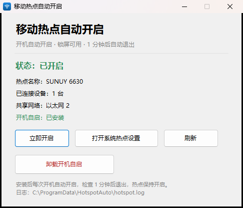

# 移动热点自动开启（HotspotAuto）

**中文** | [English](README.en.md)

一个独立的 Windows 小程序：**开机时自动开启“移动热点”**，不需要先登录桌面。
不依赖 DSH、Python、.NET 8 或任何第三方运行库，单个 exe 即可运行。

> English: A standalone Windows tool that turns on the Mobile Hotspot at boot —
> before login — then exits after a 60-second health check. No background
> process, no third-party runtime.



## 功能

- 开机自动开启移动热点，**锁屏/登录界面就已开启**（以 SYSTEM 计划任务运行）
- 启动后每 10 秒检查一次，持续约 1 分钟，确认热点稳定
- **1 分钟后程序自动退出**，不常驻进程；热点由 Windows 保持开启
- 带图形界面：查看状态、热点名称、已连接设备数、共享网络
- 一键安装/卸载开机自启，自动写入计划任务
- 日志：`C:\ProgramData\HotspotAuto\hotspot.log`

> 说明：本工具**不会**绕过 Windows 登录密码，也**不会**自动登录。
> 它只是让热点在登录之前就启动，所以你到锁屏界面时热点已经在广播了。

## 系统要求

- Windows 10（1803 及以上）或 Windows 11
- 支持“移动热点”的无线网卡（大多数笔记本/台式机无线网卡都支持）
- 无需安装 .NET 运行时（系统自带 .NET Framework 4.x）

## 下载

从 [Releases](../../releases/latest) 下载 `HotspotAuto-1.0.0.zip`，解压后运行 `HotspotAuto.exe`。
也可以直接下载 `HotspotAuto.exe`（单文件）。

## 快速开始

1. 双击 `HotspotAuto.exe`。
2. 点“**安装开机自启**”。
3. 看到“开机自启：已安装”就完成了。

> 首次运行如果出现“Windows 已保护你的电脑”，点“更多信息 → 仍要运行”
> （程序没有数字签名）。个别安全软件可能提示“创建计划任务”，请允许。

以后每次开机，热点会自动开启；程序检查约 1 分钟后自动退出，热点保持开启。
想改热点名称或密码，打开“设置 → 网络和 Internet → 移动热点”。

## 快速启动（重要）

Windows 11 默认开启“快速启动（Fast Startup）”。在这种关机方式下，
“系统启动时”的计划任务可能不会触发。程序已经额外注册了
“系统启动事件（Kernel-General 12）”触发器，并在登录时用启动项兜底；
但如果你发现**关机再开机后热点没有自动开**，可以：

- 双击 `关闭快速启动.bat`（需要管理员），下次关机再开即可；或
- 用“重启”代替“关机”（重启会走完整启动流程）。

`恢复快速启动.bat` 可以改回默认设置。

## 界面

- **状态**：已开启 / 已关闭 / 切换中
- **热点名称**：当前 SSID
- **已连接设备**：客户端数量
- **共享网络**：当前用来上网的网卡（以太网 / Wi-Fi）
- **开机自启**：是否已安装计划任务
- 按钮：立即开启、打开系统热点设置、刷新、安装/卸载开机自启

## 命令行

```text
HotspotAuto.exe            打开图形界面
HotspotAuto.exe status     查看状态
HotspotAuto.exe on         立即开启热点
HotspotAuto.exe off        立即关闭热点（若启动监控还在运行的 1 分钟内，10 秒后可能被重新打开）
HotspotAuto.exe install    安装开机自启（自动提权）
HotspotAuto.exe uninstall  卸载开机自启（自动提权）
HotspotAuto.exe install --quiet    静默安装（不弹完成提示）
HotspotAuto.exe uninstall --quiet  静默卸载
HotspotAuto.exe help       显示帮助
HotspotAuto.exe version    显示版本
```

## 工作原理

- 安装时把 exe 复制到 `C:\Program Files\HotspotAuto\`。
- 创建一个名为 `HotspotAuto` 的计划任务：
  - 以 `NT AUTHORITY\SYSTEM` 身份、最高权限运行；
  - 触发器：系统启动时（延迟 20 秒）+ 系统启动事件（Kernel-General 12）；
  - 运行 `HotspotAuto.exe run`：等待 Internet 连接后调用 Windows 自带的
    `NetworkOperatorTetheringManager` 开启热点；
  - 之后每 10 秒检查一次，持续 60 秒；确认热点稳定后进程自动退出，热点保持开启；
  - 如果 120 秒内仍没有可用的 Internet，进程也会退出，不会一直挂着。
- 另外写入当前用户的启动项（`HKCU\...\Run`）作为登录后的兜底。
- 用全局互斥量保证同一时间只有一个启动监控进程。

## 卸载

- 打开程序，点“卸载开机自启”；或
- 双击 `卸载开机自启.bat`；或
- 命令行 `HotspotAuto.exe uninstall`。

卸载会删除计划任务、启动项、`C:\Program Files\HotspotAuto` 和
`C:\ProgramData\HotspotAuto`。热点本身不会被关闭。

## 常见问题

**热点开了，但手机连上不能上网？**
检查“共享网络”是否有 Internet。程序只负责开热点，上游网络断开时热点仍保持开启；
网络恢复后手机即可上网。程序只在启动后的 1 分钟内自动重试，之后需要手动处理。

**程序会一直在后台运行吗？**
不会。每次开机只运行约 1 分钟：开启热点并检查 60 秒后自动退出，之后热点由 Windows 保持开启。
如果 120 秒内没有可用的 Internet，它也会退出，不会一直挂着。

**任务计划程序里看不到 HotspotAuto？**
需要以管理员身份打开“任务计划程序”。任务名是 `HotspotAuto`。

**Windows 提示“已保护你的电脑”？**
程序没有数字签名。点“更多信息 → 仍要运行”即可。

**安装/卸载时会不会弹 UAC？**
取决于你的 UAC 设置，可能会弹一次，允许即可。

**日志在哪？**
`C:\ProgramData\HotspotAuto\hotspot.log`。后台任务以 SYSTEM 运行，日志由它写入。

**安全吗？**
程序只调用 Windows 自带的移动热点 API，不保存热点密码、不联网上传任何数据。
计划任务以 SYSTEM 运行是本方案能在登录前开热点的关键。

## 从源码构建

需要 Windows 自带的 .NET Framework 4.x 编译器（`csc.exe`）。

```powershell
powershell -ExecutionPolicy Bypass -File .\build.ps1
```

输出：`dist\HotspotAuto.exe`。源码在 `src\HotspotAuto.cs`，单文件，无第三方依赖。

生成发布压缩包（编译 + 复制运行所需文件 + 打 zip）：

```powershell
powershell -ExecutionPolicy Bypass -File .\package.ps1
```

输出：`dist\HotspotAuto-1.0.0.zip` 和 `dist\package\`。

## 项目结构

```text
HotspotAuto/
├─ src/
│  ├─ HotspotAuto.cs     单文件程序（WinForms 界面 + WinRT 热点 API）
│  ├─ app.manifest       应用清单（asInvoker、DPI 感知）
│  └─ app.ico            程序图标
├─ docs/
│  └─ screenshot.png     界面截图
├─ build.ps1             编译脚本
├─ package.ps1           编译并生成发布 zip
├─ make-icon.py          重新生成图标（可选，需要 Pillow）
├─ README.md
├─ README.en.md
├─ 使用说明.txt
├─ CHANGELOG.md
└─ LICENSE
```

## 许可证

本项目使用 [MIT License](LICENSE) 开源。

